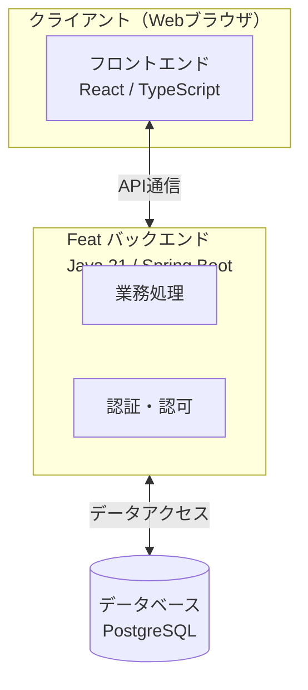
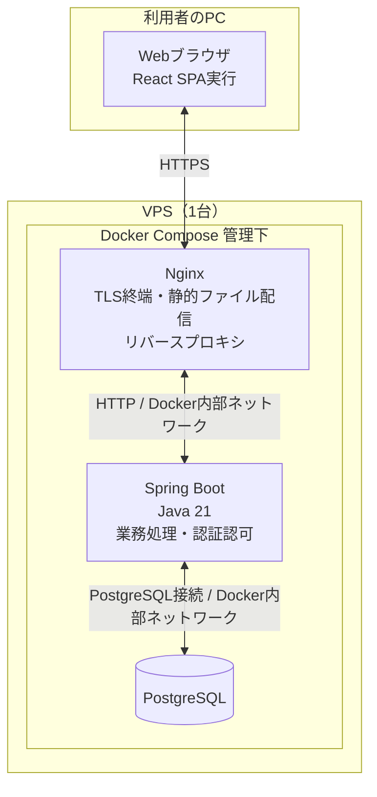

# システム構成設計書

## 1. 本書の目的

本書は、Featについて、システム全体の構成、各構成要素の責務、構成要素間の通信、および配置構成を定義する。

画面項目、APIの詳細仕様、データベースのテーブル定義、認証・認可等のセキュリティに関する詳細仕様については、それぞれの設計書に定義する。

## 2. システム概要

Featは、プロジェクトおよびタスクの情報を一元管理し、担当者、進捗、期限、レビュー、コメント、変更履歴等の業務情報を共有・管理するためのWebアプリケーションである。

本システムは、主に以下の機能群を提供する。

- 認証・ユーザー管理
- プロジェクト・プロジェクトメンバー管理
- タスク・進捗管理
- タスクのレビュー・承認ワークフロー
- コメント・変更履歴管理
- 検索・個人タスク管理
- ダッシュボード

機能の詳細および初期リリースの対象外機能については、システム要求仕様書「3. 対象範囲」「5. 機能要求」「9. 対象外機能」に従う。

## 3. システム全体構成

本システムは、以下の構成要素を基本として設計する。

1. クライアント（Webブラウザ）
2. フロントエンド
3. バックエンド
4. データベース

フロントエンドはSPA（Single Page Application）として実装する。

バックエンドは業務処理と認証・認可を担当し、独立した認証サーバーは設けない。

各構成要素の責務および通信方式については、以降の節で定義する。

### 3.1 システム構成図

上記はシステムの論理構成を表す。

フロントエンドはWebブラウザ上で実行し、バックエンドとはAPIを介して通信する。

バックエンドは業務処理および認証・認可を担当し、データベースへのアクセスを行う。

なお、論理構成図のAPI通信は構成要素間の関係を示したものであり、実際の通信はNginxを経由する。通信経路の詳細は第3.3節に定義する。

### 3.2 各構成要素の責務

| 構成要素 | 主な責務 |
|---|---|
| クライアント（Webブラウザ） | フロントエンドの実行環境を提供する |
| フロントエンド | 画面表示、入力受付、API呼び出し、処理結果の表示 |
| バックエンド | 業務ロジックの実行、認証・認可、入力値の検証、データアクセス |
| データベース | 業務データおよび認証関連データの永続化、データ整合性の維持 |

バックエンド内部では、認証・認可と業務処理の責務を分離する。

具体的な認証方式、セッション管理、権限判定方法等はセキュリティ設計書に定義する。

### 3.3 構成要素間の通信

| 通信元 | 通信先 | 通信方式 | 用途 |
|---|---|---|---|
| Webブラウザ | Nginx | HTTPS | フロントエンドの取得、JSON形式のAPI通信 |
| Nginx | Spring Boot | HTTP（Docker内部ネットワーク） | APIリクエストの転送 |
| Spring Boot | PostgreSQL | PostgreSQLの通信プロトコル（Docker内部ネットワーク） | 業務データおよび認証関連データの参照・更新 |

Webブラウザとバックエンド間のAPI通信は、Nginxを経由する。

WebブラウザからNginxまではHTTPSを使用し、NginxからバックエンドへはDocker内部ネットワーク上のHTTPを使用する。

バックエンドおよびデータベースの通信ポートは外部に公開しない。

## 4. 配置構成

本システムは、1台のVPS上にサーバー側の構成要素を配置する。

サーバー側の構成要素はDockerコンテナとして実行し、Docker Composeで管理する。

フロントエンドはNginxから利用者のWebブラウザへ配信し、ブラウザ上で実行する。

### 4.1 配置構成図

外部からのHTTPS通信はNginxで受け付け、TLS終端を行う。

Nginxはフロントエンドの静的ファイル配信、およびAPIリクエストのバックエンドへの転送を担当する。

バックエンドとデータベースは、Docker内部ネットワークを介して通信する。

### 4.2 各構成要素の配置先

| 構成要素 | 配置先 | 実行・管理方法 |
|---|---|---|
| クライアント | 利用者のPC | Webブラウザ |
| フロントエンド | 利用者のWebブラウザ | Nginxから配信されたReact SPAを実行 |
| Webサーバー（Nginx） | VPS | Dockerコンテナ |
| バックエンド（Spring Boot） | VPS | Dockerコンテナ |
| データベース（PostgreSQL） | VPS | Dockerコンテナ |

Nginx、Spring Boot、PostgreSQLは、それぞれ独立したコンテナとして構成する。

Docker Composeによってコンテナの構成、起動および停止を管理する。

PostgreSQLの永続化領域は、コンテナの再作成によってデータが失われないように構成する。

### 4.3 外部からのアクセス経路

利用者はWebブラウザからHTTPSを使用してFeatにアクセスする。

外部からの通信はNginxで受け付け、TLS終端を行う。

Nginxは以下の処理を担当する。

- フロントエンドの静的ファイルの配信
- APIリクエストのSpring Bootへの転送

NginxからSpring Bootへの転送には、Docker内部ネットワーク上のHTTPを使用する。

Spring BootおよびPostgreSQLは、利用者から直接アクセスさせない。

TLS証明書の取得・更新方法やネットワーク設定の詳細は、後続の構築・運用設計で決定する。

## 5. 主要な設計方針

### 5.1 アーキテクチャ方針

Featは、将来的に機能を統合したオールインワン型アプリケーションへ拡張する方針とする。

複数の独立したサービスに共通認証基盤を提供する構成を想定しないため、認証機能はバックエンドの内部機能として実装し、独立した認証サーバーは設けない。

バックエンド内部では、業務機能間の責務分離、モジュール境界の明確化、および変更時の整合性確保を重視する。

認証・認可の具体的な方式はセキュリティ設計書に定義する。

### 5.2 技術スタック

本システムでは、以下の技術を採用する。

| 項目 | 採用技術 |
|---|---|
| フロントエンド | React |
| フロントエンド実装言語 | TypeScript |
| 開発・ビルドツール | Vite |
| バックエンド | Spring Boot |
| バックエンド実装言語 | Java 21 |
| データベース | PostgreSQL |
| Webサーバー | Nginx |
| コンテナ管理 | Docker Compose |

#### 5.2.1 フロントエンド技術の選定理由

ReactとVueはいずれも本システムの要求を満たす技術であるが、開発者の経験および記述方式の好みを考慮し、Reactを採用する。

実装言語にはTypeScript、開発・ビルドツールにはViteを採用する。

フロントエンドはSPAとして構築し、本番環境ではViteによって生成した静的ファイルをNginxから配信する。

#### 5.2.2 バックエンド技術の選定理由

バックエンドにはJava 21およびSpring Bootを採用する。

将来的な機能拡張を考慮し、Javaの静的型付けとSpring Frameworkの依存性注入等の仕組みを活用して、業務ロジックを構造化する。

PHP / Laravelでも本システムの要求を満たすことは可能であり、本選定は実装可能性の優劣によるものではない。

Spring Bootの具体的なバージョンおよび採用ライブラリは、実装要件と互換性を確認して決定する。

#### 5.2.3 データベース製品の選定理由

データベースにはPostgreSQLを採用する。

Featでは、ユーザー、プロジェクト、タスク、コメント、変更履歴等の関連する業務データを管理するため、リレーショナルデータベースを使用する。

PostgreSQLのトランザクション管理、外部キー制約、一意制約等を利用し、業務データの整合性を確保する。

MySQLも本システムの要求を満たす選択肢であり、本選定は両者の性能比較によるものではない。

#### 5.2.4 Webサーバーの選定理由

WebサーバーにはNginxを採用する。

Nginxは、静的ファイル配信、リバースプロキシ、TLS終端を担当する。

Apache HTTP Serverも同様の用途に対応可能であるが、本システムではNginxを採用する。両者の性能比較による選定ではない。

### 5.3 配置・通信方針

本システムのサーバー側構成要素は、1台のVPS上に配置する。

Nginx、Spring Boot、PostgreSQLは、それぞれ独立したDockerコンテナとして構成し、Docker Composeで管理する。

外部からのHTTPS通信はNginxで終端する。

NginxからSpring Bootへの通信にはDocker内部ネットワーク上のHTTPを使用する。

Spring BootとPostgreSQLの通信には、PostgreSQLの通信プロトコルを使用する。

バックエンドおよびデータベースの通信ポートは外部に公開しない。

データベースの永続化領域は、コンテナの再作成によってデータが失われないように構成する。

## 6. 後続工程で具体化する事項

以下の事項は、主要な構成方針の決定後、関連する設計・構築・運用工程で具体化する。

| 項目 | 具体化する内容 | 主な対象工程 |
|---|---|---|
| データベース接続 | 接続設定、暗号化の要否 | 詳細設計・セキュリティ設計 |
| TLS証明書 | 証明書の取得・更新方法 | 構築・運用設計 |
| コンテナ構成 | Docker Composeの具体的な設定、ネットワーク、ボリューム等 | 詳細設計・環境構築 |
| バックアップ | データのバックアップ、保管先、復元方法 | 運用設計 |
| 監視・障害復旧 | 監視対象、ログ管理、障害検知、復旧手順 | 運用設計 |
| 性能検証 | 仮想ユーザーを用いた負荷試験により、同時利用者100名程度を想定した条件での応答時間、エラー率、リソース使用状況を確認する | 性能試験 |
本システムは単一VPS構成であるため、VPS自体の障害はシステム全体に影響する。

障害時のデータ保全および復旧については、後続の運用設計で具体的な方針を決定する。

上記の事項は、後続工程で決定し、必要に応じて本書または関連設計書へ反映する。