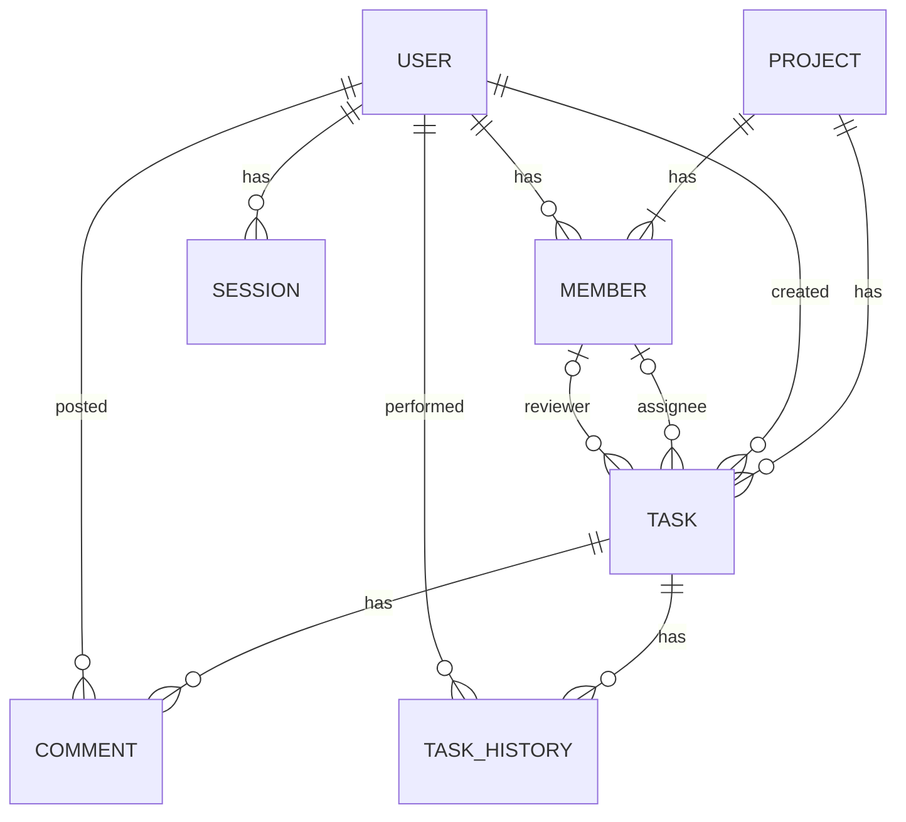

# データ設計書

## 1. 本書の目的

本書は、Featで使用するデータベースについて、格納するデータの構造、データ間の関係、およびデータの整合性を維持するための制約を定義する。

## 2. データモデル概要

### DD-USER ユーザー
Featを利用するユーザーの情報を管理する。

### DD-PROJECT プロジェクト
プロジェクトの基本情報を管理する。

### DD-TASK タスク
プロジェクトに属するタスクの基本情報、担当者およびレビュアーの割当情報を管理する。

### DD-TASK_HISTORY タスク変更履歴
タスクに対する変更内容、変更日時および変更者に関する履歴を管理する。

### DD-COMMENT コメント
タスクに属するコメントを管理する。

### DD-MEMBER プロジェクトメンバー
ユーザーとプロジェクトの所属関係、およびプロジェクト内での役割を管理する。

### DD-SESSION ログインセッション
ユーザーのログインセッションおよびその有効期限に関する情報を管理する。

## 3. ER図



## 4. テーブル定義

表中の`FK = TRUE`は外部キー参照列を表す。`UNIQUE = TRUE`は単独列の一意制約を表し、複合UNIQUE制約は各テーブルの制約欄に定義する。

日時は`TIMESTAMPTZ`とする。`created_at`は作成時に設定して変更しない。`updated_at`はINSERT時に初期化し、その後の更新時にアプリケーションが更新する。

制約欄のSQL断片は`CREATE TABLE`内に記載するテーブル制約の定義を表す。SQL断片間はカンマで区切る。

### 4.1 users

| 項番 | カラム名 | 論理名 | データ型 | 桁数/データサイズ | NULL許可 | 主キー(PK) | 外部キー(FK) | UNIQUE制約 | コメント |
| --- | --- | --- | --- | --- | --- | --- | --- | --- | --- |
| 1 | id | ユーザーID | BIGINT | 8 Byte | FALSE | TRUE | FALSE | FALSE | GENERATED ALWAYS AS IDENTITY |
| 2 | mail_address | メールアドレス | VARCHAR | 254 | FALSE | FALSE | FALSE | TRUE | システム内で一意 |
| 3 | name | 氏名 | VARCHAR | 100 | FALSE | FALSE | FALSE | FALSE |  |
| 4 | screen_name | 表示名 | VARCHAR | 100 | FALSE | FALSE | FALSE | FALSE |  |
| 5 | department | 所属 | VARCHAR | 100 | TRUE | FALSE | FALSE | FALSE |  |
| 6 | administrator | システム管理者権限 | BOOLEAN | 1 Byte | FALSE | FALSE | FALSE | FALSE | DEFAULT FALSE |
| 7 | is_available | 利用状態 | BOOLEAN | 1 Byte | FALSE | FALSE | FALSE | FALSE | DEFAULT TRUE。FALSEは利用停止 |
| 8 | password_hash | パスワードハッシュ値 | VARCHAR | 255 | FALSE | FALSE | FALSE | FALSE | Argon2でハッシュ化 |
| 9 | must_change_password | パスワード変更要求 | BOOLEAN | 1 Byte | FALSE | FALSE | FALSE | FALSE | 初期・一時パスワード設定時TRUE |
| 10 | failed_login_count | 連続認証失敗回数 | INTEGER | 4 Byte | FALSE | FALSE | FALSE | FALSE | DEFAULT 0 |
| 11 | last_failed_login_at | 最終認証失敗日時 | TIMESTAMPTZ | 8 Byte | TRUE | FALSE | FALSE | FALSE |  |
| 12 | locked_at | ログイン制限開始日時 | TIMESTAMPTZ | 8 Byte | TRUE | FALSE | FALSE | FALSE |  |
| 13 | created_at | 作成日時 | TIMESTAMPTZ | 8 Byte | FALSE | FALSE | FALSE | FALSE | DEFAULT CURRENT_TIMESTAMP。変更不可 |
| 14 | updated_at | 更新日時 | TIMESTAMPTZ | 8 Byte | FALSE | FALSE | FALSE | FALSE | DEFAULT CURRENT_TIMESTAMP。更新時はアプリケーションが設定 |

#### CHECK制約

```sql
CONSTRAINT chk_users_failed_login_count CHECK (failed_login_count >= 0)
```

認証失敗回数・ロック解除の条件は業務ロジックで判定する。メールアドレスの一意性はUNIQUEで保証する。

### 4.2 projects

| 項番 | カラム名 | 論理名 | データ型 | 桁数/データサイズ | NULL許可 | 主キー(PK) | 外部キー(FK) | UNIQUE制約 | コメント |
| --- | --- | --- | --- | --- | --- | --- | --- | --- | --- |
| 1 | id | プロジェクトID | BIGINT | 8 Byte | FALSE | TRUE | FALSE | FALSE | GENERATED ALWAYS AS IDENTITY |
| 2 | public_id | 外部プロジェクトID | UUID | 16 Byte | FALSE | FALSE | FALSE | TRUE | DEFAULT gen_random_uuid() |
| 3 | name | プロジェクト名 | VARCHAR | 100 | FALSE | FALSE | FALSE | FALSE |  |
| 4 | description | プロジェクト概要 | VARCHAR | 2000 | TRUE | FALSE | FALSE | FALSE |  |
| 5 | start_date | 開始日 | DATE | 4 Byte | FALSE | FALSE | FALSE | FALSE |  |
| 6 | planned_end_date | 終了予定日 | DATE | 4 Byte | FALSE | FALSE | FALSE | FALSE |  |
| 7 | status | プロジェクトステータス | VARCHAR | 20 | FALSE | FALSE | FALSE | FALSE | DEFAULT 'draft' |
| 8 | created_at | 作成日時 | TIMESTAMPTZ | 8 Byte | FALSE | FALSE | FALSE | FALSE | DEFAULT CURRENT_TIMESTAMP。変更不可 |
| 9 | updated_at | 更新日時 | TIMESTAMPTZ | 8 Byte | FALSE | FALSE | FALSE | FALSE | DEFAULT CURRENT_TIMESTAMP。更新時はアプリケーションが設定 |

#### CHECK制約

```sql
CONSTRAINT chk_projects_status
CHECK (status IN ('draft', 'active', 'completed', 'cancelled')),

CONSTRAINT chk_projects_dates
CHECK (planned_end_date >= start_date)
```

プロジェクト管理者は`members.is_manager`で表現し、`projects`に管理者IDを保持しない。

### 4.3 tasks

| 項番 | カラム名 | 論理名 | データ型 | 桁数/データサイズ | NULL許可 | 主キー(PK) | 外部キー(FK) | UNIQUE制約 | コメント |
| --- | --- | --- | --- | --- | --- | --- | --- | --- | --- |
| 1 | id | タスクID | BIGINT | 8 Byte | FALSE | TRUE | FALSE | FALSE | GENERATED ALWAYS AS IDENTITY |
| 2 | project_id | プロジェクトID | BIGINT | 8 Byte | FALSE | FALSE | TRUE | FALSE | projects.idを参照 |
| 3 | public_id | 外部タスクID | UUID | 16 Byte | FALSE | FALSE | FALSE | TRUE | DEFAULT gen_random_uuid() |
| 4 | title | タイトル | VARCHAR | 200 | FALSE | FALSE | FALSE | FALSE |  |
| 5 | description | 内容 | VARCHAR | 5000 | TRUE | FALSE | FALSE | FALSE |  |
| 6 | assignee_member_id | 担当メンバーID | BIGINT | 8 Byte | TRUE | FALSE | TRUE | FALSE | members(id, project_id)を複合参照 |
| 7 | reviewer_member_id | レビューメンバーID | BIGINT | 8 Byte | TRUE | FALSE | TRUE | FALSE | members(id, project_id)を複合参照 |
| 8 | status | タスクステータス | VARCHAR | 20 | FALSE | FALSE | FALSE | FALSE | DEFAULT 'not_started' |
| 9 | priority | 優先度 | VARCHAR | 10 | FALSE | FALSE | FALSE | FALSE | low / medium / high / urgent |
| 10 | planned_start_date | 開始予定日 | DATE | 4 Byte | FALSE | FALSE | FALSE | FALSE |  |
| 11 | due_date | 期限 | DATE | 4 Byte | FALSE | FALSE | FALSE | FALSE |  |
| 12 | created_by | 作成者ID | BIGINT | 8 Byte | FALSE | FALSE | TRUE | FALSE | users.idを参照。変更不可 |
| 13 | is_active | 有効状態 | BOOLEAN | 1 Byte | FALSE | FALSE | FALSE | FALSE | DEFAULT TRUE。FALSEは無効化 |
| 14 | created_at | 作成日時 | TIMESTAMPTZ | 8 Byte | FALSE | FALSE | FALSE | FALSE | DEFAULT CURRENT_TIMESTAMP。変更不可 |
| 15 | updated_at | 更新日時 | TIMESTAMPTZ | 8 Byte | FALSE | FALSE | FALSE | FALSE | DEFAULT CURRENT_TIMESTAMP。更新時はアプリケーションが設定 |

#### CHECK制約

```sql
CONSTRAINT chk_tasks_status
CHECK (status IN (
    'not_started', 'in_progress', 'review_requested',
    'in_review', 'returned', 'completed'
)),

CONSTRAINT chk_tasks_priority
CHECK (priority IN ('low', 'medium', 'high', 'urgent')),

CONSTRAINT chk_tasks_dates
CHECK (due_date >= planned_start_date),

CONSTRAINT chk_tasks_distinct_members
CHECK (
    assignee_member_id IS NULL
    OR reviewer_member_id IS NULL
    OR assignee_member_id <> reviewer_member_id
)
```

#### 外部キー制約

```sql
CONSTRAINT fk_tasks_project
FOREIGN KEY (project_id) REFERENCES projects (id),

CONSTRAINT fk_tasks_creator
FOREIGN KEY (created_by) REFERENCES users (id),

CONSTRAINT fk_tasks_assignee
FOREIGN KEY (assignee_member_id, project_id)
REFERENCES members (id, project_id),

CONSTRAINT fk_tasks_reviewer
FOREIGN KEY (reviewer_member_id, project_id)
REFERENCES members (id, project_id)
```

担当者とレビュアーが対象プロジェクトのメンバーであることを複合外部キーで保証する。対象メンバーが利用可能か、`members.is_active = TRUE`か、および変更時の業務条件はアプリケーションで確認する。メンバー除外との競合はトランザクションで制御する。

### 4.4 task_histories

| 項番 | カラム名 | 論理名 | データ型 | 桁数/データサイズ | NULL許可 | 主キー(PK) | 外部キー(FK) | UNIQUE制約 | コメント |
| --- | --- | --- | --- | --- | --- | --- | --- | --- | --- |
| 1 | id | 履歴ID | BIGINT | 8 Byte | FALSE | TRUE | FALSE | FALSE | GENERATED ALWAYS AS IDENTITY |
| 2 | task_id | タスクID | BIGINT | 8 Byte | FALSE | FALSE | TRUE | FALSE | tasks.idを参照 |
| 3 | actor_id | 操作者ID | BIGINT | 8 Byte | FALSE | FALSE | TRUE | FALSE | users.idを参照 |
| 4 | action | 操作種別 | VARCHAR | 50 | FALSE | FALSE | FALSE | FALSE | 英語コード |
| 5 | field_name | 変更項目名 | VARCHAR | 50 | TRUE | FALSE | FALSE | FALSE | 項目変更以外のイベントはNULL |
| 6 | old_value | 変更前値 | TEXT | 可変長 | TRUE | FALSE | FALSE | FALSE |  |
| 7 | new_value | 変更後値 | TEXT | 可変長 | TRUE | FALSE | FALSE | FALSE |  |
| 8 | reason | 操作理由 | TEXT | 可変長 | TRUE | FALSE | FALSE | FALSE | 差し戻し理由等 |
| 9 | created_at | 操作日時 | TIMESTAMPTZ | 8 Byte | FALSE | FALSE | FALSE | FALSE | DEFAULT CURRENT_TIMESTAMP。変更不可 |

#### 変更履歴の記録単位

- 項目変更は、1レコードにつき1項目を記録する。複数項目の変更時は項目ごとに登録する。
- 操作イベント（作成・レビュー依頼・承認・差し戻し・再オープン・無効化など）は、`action`に操作種別を記録する。項目変更を伴わないイベントでは`field_name`、`old_value`、`new_value`をNULLとする。
- 1回の操作で項目変更とイベントが発生した場合、必要な項目変更履歴とイベント履歴を同一トランザクション内で登録する。
- `old_value`、`new_value`は対応する項目の変更前後値を文字列化して保持する。NULLは値が存在しないことを表す。
- タスク更新と履歴登録は同一トランザクションで実行し、履歴は利用者に更新・削除させない。
- `action`、`field_name`のコードは実装時に一元管理し、UI表示文言とは分離する。

### 4.5 comments

| 項番 | カラム名 | 論理名 | データ型 | 桁数/データサイズ | NULL許可 | 主キー(PK) | 外部キー(FK) | UNIQUE制約 | コメント |
| --- | --- | --- | --- | --- | --- | --- | --- | --- | --- |
| 1 | id | コメントID | BIGINT | 8 Byte | FALSE | TRUE | FALSE | FALSE | GENERATED ALWAYS AS IDENTITY |
| 2 | task_id | タスクID | BIGINT | 8 Byte | FALSE | FALSE | TRUE | FALSE | tasks.idを参照 |
| 3 | author_id | 投稿者ID | BIGINT | 8 Byte | FALSE | FALSE | TRUE | FALSE | users.idを参照。変更不可 |
| 4 | content | 本文 | VARCHAR | 5000 | FALSE | FALSE | FALSE | FALSE |  |
| 5 | is_deleted | 削除状態 | BOOLEAN | 1 Byte | FALSE | FALSE | FALSE | FALSE | DEFAULT FALSE。論理削除 |
| 6 | created_at | 投稿日時 | TIMESTAMPTZ | 8 Byte | FALSE | FALSE | FALSE | FALSE | DEFAULT CURRENT_TIMESTAMP。変更不可 |
| 7 | updated_at | 更新日時 | TIMESTAMPTZ | 8 Byte | FALSE | FALSE | FALSE | FALSE | DEFAULT CURRENT_TIMESTAMP。編集時に更新 |
| 8 | edited_at | 最終編集日時 | TIMESTAMPTZ | 8 Byte | TRUE | FALSE | FALSE | FALSE | 編集前はNULL。編集時に設定し、編集済み表示に使用 |
| 9 | deleted_at | 削除日時 | TIMESTAMPTZ | 8 Byte | TRUE | FALSE | FALSE | FALSE | 削除前はNULL |

#### CHECK制約

```sql
CONSTRAINT chk_comments_deletion
CHECK (
    (is_deleted = FALSE AND deleted_at IS NULL)
    OR (is_deleted = TRUE AND deleted_at IS NOT NULL)
)
```

削除済みコメントは本文を画面に表示しない。保存済みの本文を物理削除する必要はない。

### 4.6 members

| 項番 | カラム名 | 論理名 | データ型 | 桁数/データサイズ | NULL許可 | 主キー(PK) | 外部キー(FK) | UNIQUE制約 | コメント |
| --- | --- | --- | --- | --- | --- | --- | --- | --- | --- |
| 1 | id | メンバーID | BIGINT | 8 Byte | FALSE | TRUE | FALSE | FALSE | GENERATED ALWAYS AS IDENTITY |
| 2 | project_id | プロジェクトID | BIGINT | 8 Byte | FALSE | FALSE | TRUE | FALSE | projects.idを参照 |
| 3 | user_id | ユーザーID | BIGINT | 8 Byte | FALSE | FALSE | TRUE | FALSE | users.idを参照 |
| 4 | is_manager | プロジェクト管理者権限 | BOOLEAN | 1 Byte | FALSE | FALSE | FALSE | FALSE | DEFAULT FALSE |
| 5 | is_active | 所属状態 | BOOLEAN | 1 Byte | FALSE | FALSE | FALSE | FALSE | DEFAULT TRUE。FALSEは除外済み |
| 6 | created_at | 登録日時 | TIMESTAMPTZ | 8 Byte | FALSE | FALSE | FALSE | FALSE | DEFAULT CURRENT_TIMESTAMP。変更不可 |
| 7 | updated_at | 更新日時 | TIMESTAMPTZ | 8 Byte | FALSE | FALSE | FALSE | FALSE | DEFAULT CURRENT_TIMESTAMP。更新時はアプリケーションが設定 |

#### UNIQUE制約

```sql
CONSTRAINT uq_members_project_user
UNIQUE (project_id, user_id),

CONSTRAINT uq_members_id_project
UNIQUE (id, project_id)
```

`uq_members_id_project`は`tasks`の複合外部キーの参照先に必要な制約である。

除外時には`is_active = FALSE`とし、過去のタスクや履歴からの参照を保持する。再追加時は既存レコードを再有効化する。現在の管理者人数は`is_active = TRUE AND is_manager = TRUE`の行で数える。最低人数の維持と競合対策はトランザクションで保証する。

### 4.7 sessions

| 項番 | カラム名 | 論理名 | データ型 | 桁数/データサイズ | NULL許可 | 主キー(PK) | 外部キー(FK) | UNIQUE制約 | コメント |
| --- | --- | --- | --- | --- | --- | --- | --- | --- | --- |
| 1 | id | セッションID | BIGINT | 8 Byte | FALSE | TRUE | FALSE | FALSE | GENERATED ALWAYS AS IDENTITY |
| 2 | user_id | ユーザーID | BIGINT | 8 Byte | FALSE | FALSE | TRUE | FALSE | users.idを参照。複数セッションを許容 |
| 3 | token_hash | セッショントークンハッシュ | VARCHAR | 64 | FALSE | FALSE | FALSE | TRUE | ランダムトークンのSHA-256を16進文字列で保持 |
| 4 | created_at | ログイン日時 | TIMESTAMPTZ | 8 Byte | FALSE | FALSE | FALSE | FALSE | DEFAULT CURRENT_TIMESTAMP |
| 5 | last_activity_at | 最終操作日時 | TIMESTAMPTZ | 8 Byte | FALSE | FALSE | FALSE | FALSE | DEFAULT CURRENT_TIMESTAMP。認証済み操作で更新 |
| 6 | expires_at | 絶対有効期限 | TIMESTAMPTZ | 8 Byte | FALSE | FALSE | FALSE | FALSE | ログイン日時から8時間後 |
| 7 | revoked_at | 失効日時 | TIMESTAMPTZ | 8 Byte | TRUE | FALSE | FALSE | FALSE | 未失効はNULL。ログアウト等で設定 |

#### CHECK制約

```sql
CONSTRAINT chk_sessions_expires_at
CHECK (expires_at > created_at),

CONSTRAINT chk_sessions_last_activity
CHECK (last_activity_at >= created_at)
```

認証時は`revoked_at IS NULL`、`expires_at`未到達、最終操作から30分未満の条件を確認する。セッション終了は対象の`revoked_at`を設定する。

## 5. 参照整合性・更新方針

### 5.1 外部キーの共通方針

各外部キーは、明記した参照先への制約を付与する。削除・主キー変更による意図しない履歴喪失を防ぐため、初期設計では`ON DELETE NO ACTION`、`ON UPDATE NO ACTION`（PostgreSQLの既定値）とし、`CASCADE`は使用しない。

`tasks`に定義した複合外部キーは、担当者・レビュアーの所属プロジェクトとの一致を保証する。`members.id`と`members.project_id`は作成後変更しない。

### 5.2 アプリケーションとDBの責務

- DB：主キー・外部キー・一意制約・行内CHECKによる整合性を保証する。
- アプリケーション：利用権限、状態遷移、メンバーの有効状態、操作条件を判定する。
- トランザクション：管理者・メンバー最低人数、利用停止と担当者割当の競合、タスク更新と履歴保存などを一貫して処理する。

業務上の制約を維持するため、同一プロジェクトへの管理者変更・メンバー除外などは対象`projects`行のロックを共通の取得順序で行う。ユーザーの管理者権限変更・利用停止についても同時実行時に最後の利用可能な管理者を失わない制御を別途設計する。

### 5.3 データ整合性・排他制御

#### 基本方針

複数のレコードにまたがる業務上の整合性は、トランザクションと排他制御によって保証する。

- 整合性の検証と更新は同一トランザクションで実行する。
- 競合する更新処理では、共通の対象レコードをロックする。
- 必要なロックを取得した後、更新条件を再確認する。
- ロック取得順序を処理間で統一し、デッドロックを防止する。
- 更新または履歴登録に失敗した場合、トランザクション全体をロールバックする。

行ロックにはPostgreSQLの `SELECT FOR UPDATE` を使用する。

複数種類のレコードをロックする場合は、原則として以下の順序とする。

1. システム管理者数を保護する共通ロック（必要な場合）
2. users
3. projects
4. tasks
5. members

同一テーブル内で複数行をロックする場合は、IDの昇順とする。

ロック対象の特定に必要な事前参照は許容するが、更新可否の最終判定はロック取得後に実施する。

#### プロジェクト作成

プロジェクトの作成と初期管理者のメンバー登録は、同一トランザクションで実行する。

初期管理者となるユーザーをロックし、利用可能状態を確認する。

projectsの登録後、membersに対象ユーザーを `is_active = TRUE`、`is_manager = TRUE` で登録する。

すべての登録が成功した場合のみコミットする。

#### プロジェクトメンバー管理

メンバー追加・除外・管理者権限変更は、対象projectsレコードをロックした上で実行する。

- 除外後も有効なメンバーが1名以上存在すること。
- 除外後も有効なプロジェクト管理者が1名以上存在すること。
- 未完了タスクの担当者またはレビュアーが、役割を保持したまま除外されないこと。
- 完了・中止プロジェクトのメンバー情報を変更しないこと。

メンバー追加・再追加では対象usersレコードも先にロックし、利用可能状態を確認する。

除外時は `is_active = FALSE` とする。過去の参照関係は保持する。

再追加時は既存レコードを再有効化し、管理者権限を自動復元せず、追加時の指定に従って設定する。

#### タスク管理

タスク作成・変更・無効化・状態遷移では、対象projectsレコードをロックする。

既存タスクの更新では、対象tasksレコードもロックする。

担当者・レビュアーの新規設定または変更では、対象ユーザーを先にロックして利用状態を確認し、その後にプロジェクトと必要なメンバー情報をロックして所属状態を確認する。

以下の整合性を保証する。

- プロジェクト状態による操作制限
- タスク状態による操作制限
- 担当者とレビュアーの所属・利用状態
- 状態遷移仕様書に定める遷移条件
- タスク更新と変更履歴登録の一体性

タスク更新とtask_historiesへの履歴登録は同一トランザクションで実行する。

#### プロジェクト状態変更

プロジェクト状態変更では、対象projectsレコードをロックする。

進行中への変更時は、有効なメンバー数と管理者数を確認する。

完了への変更時は、未完了タスクが存在しないことを確認する。

タスク作成・変更とプロジェクト状態変更で同じprojectsレコードをロックすることにより、状態変更中の競合を防止する。

#### ユーザー利用停止・管理者権限変更

ユーザー利用停止では、対象usersレコードと関係するprojectsレコードをロックする。

利用停止後も以下の条件を満たすことを確認する。

- 利用可能なシステム管理者が1名以上存在する。
- 準備中・進行中のプロジェクトで有効な管理者が1名以上存在する。
- 未完了タスクの担当者・レビュアーとして対象ユーザーが残っていない。

ユーザー利用停止と全ログインセッションの失効は同一トランザクションで実行する。

システム管理者の権限変更と利用停止では、利用可能なシステム管理者数を保護する共通のトランザクション単位の排他ロックを取得する。

初期システム管理者の登録は、初期構築処理で保証する。

#### コメント管理

コメントの投稿・編集・削除では、対象projectsレコードをロックし、プロジェクトおよびタスクの状態を確認する。

編集・削除では対象commentsレコードもロックする。

削除は論理削除とし、削除状態と削除日時を同一トランザクションで更新する。

#### セッション管理

ログアウトでは対象セッションのみ失効させる。

パスワード変更・再設定・ユーザー利用停止では、対象ユーザーの全セッションを失効させる。

認証情報の変更と必要なセッション失効は、同一トランザクションで実行する。

## 6. インデックス設計

### 6.1 基本方針

インデックスは、データ検索およびテーブル結合の性能を確保するために設計する。

以下の方針とする。

- PRIMARY KEYおよびUNIQUE制約に伴うインデックスはPostgreSQLが自動生成する。
- 外部キー列にはインデックスが自動生成されないため、検索条件および結合条件に応じて追加する。
- 不要なインデックスはINSERT・UPDATE・DELETE時の負荷となるため、必要最小限とする。
- 初期インデックスを定義し、実装後の実行計画および性能試験によって最終的な採否を判断する。
- 無効化タスクを通常の検索対象から除外するため、必要に応じて部分インデックスを使用する。

### 6.2 初期インデックス一覧

以下を初期インデックス候補とする。

| ID | テーブル | 対象カラム | 用途 |
| --- | --- | --- | --- |
| IDX-001 | tasks | project_id, status | プロジェクト別タスク一覧・進捗集計 |
| IDX-002 | tasks | assignee_member_id, status | 担当タスク一覧 |
| IDX-003 | tasks | reviewer_member_id, status | レビュー対象一覧 |
| IDX-004 | tasks | due_date | 期限超過・期限接近タスク検索 |
| IDX-005 | task_histories | task_id, created_at, id | タスク変更履歴の時系列表示 |
| IDX-006 | comments | task_id, created_at, id | タスクコメントの時系列表示 |
| IDX-007 | members | user_id, project_id | ユーザーの参加プロジェクト検索 |
| IDX-008 | sessions | user_id | ユーザー単位のセッション失効 |

### 6.3 インデックス定義

```sql
-- IDX-001 プロジェクト別タスク一覧
CREATE INDEX idx_tasks_project_status
ON tasks (project_id, status)
WHERE is_active = TRUE;

-- IDX-002 担当タスク一覧
CREATE INDEX idx_tasks_assignee_status
ON tasks (assignee_member_id, status)
WHERE is_active = TRUE;

-- IDX-003 レビュー対象一覧
CREATE INDEX idx_tasks_reviewer_status
ON tasks (reviewer_member_id, status)
WHERE is_active = TRUE;

-- IDX-004 期限検索
CREATE INDEX idx_tasks_due_date
ON tasks (due_date)
WHERE is_active = TRUE;

-- IDX-005 タスク変更履歴
CREATE INDEX idx_task_histories_task_created
ON task_histories (task_id, created_at, id);

-- IDX-006 タスクコメント
CREATE INDEX idx_comments_task_created
ON comments (task_id, created_at, id);

-- IDX-007 ユーザー別プロジェクトメンバー
CREATE INDEX idx_members_user_project
ON members (user_id, project_id);

-- IDX-008 ユーザー別セッション
CREATE INDEX idx_sessions_user
ON sessions (user_id);
```

### 6.4 キーワード検索

タスクのキーワード検索は、tasks.titleおよびtasks.descriptionを対象とする。

部分一致検索に対応するため、PostgreSQLのpg_trgm拡張とGINインデックスの利用を候補とする。

ただし、検索SQLおよび想定データ件数が確定していないため、初期段階では追加を必須としない。

検索方式の確定後、必要に応じてインデックスを追加する。

### 6.5 性能検証

インデックスの有効性は、実際の検索SQLと想定データ量を使用して検証する。

以下を確認する。

- EXPLAIN ANALYZEによる実行計画
- インデックスの使用状況
- タスク一覧・検索の応答時間
- ダッシュボード集計の応答時間
- インデックス追加による更新処理への影響

検証結果に応じて、インデックスの追加・変更・削除を行う。

初期リリースでは同時利用者100名程度を想定し、通常の一覧画面について原則3秒以内の応答を目標とする。

## 7. 内部コードとUI表示

DB・API・Java・TypeScriptで扱う識別子と列挙値は英語で統一し、日本語の表示文言はUI側で変換する。英語コードは要求仕様に定められた状態の意味を変更しない。
