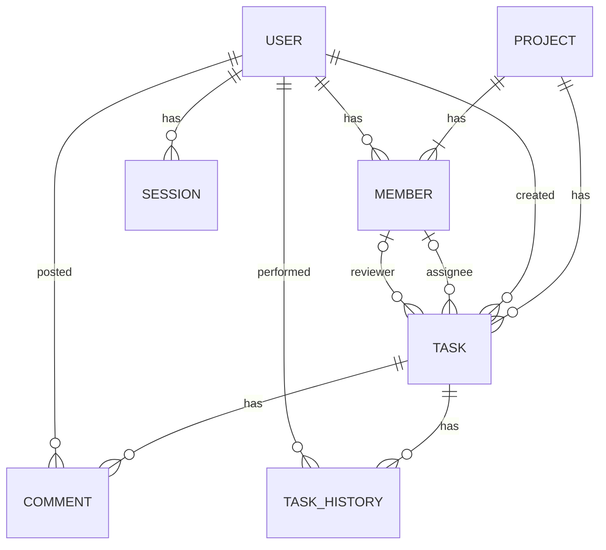

# データ設計書
## 1. 本書の目的
本書は、Featで使用するデータベースについて、格納するデータの構造、データ間の関係、
およびデータの整合性を維持するための制約を定義することを目的とする。

## 2. データモデル概要
### DD-USER ユーザー
Featを利用するユーザーの情報を管理する

### DD-PROJECT プロジェクト
プロジェクトの基本情報を管理する

### DD-TASK タスク
プロジェクトに属するタスクの基本情報、担当者およびレビュアーの割当情報を管理する。

### DD-TASK_HISTORY タスク変更履歴
タスクに対する変更内容、変更日時および変更者に関する履歴を管理する。

### DD-COMMENT コメント
タスクに属するコメントを管理する

### DD-MEMBER プロジェクトメンバー
ユーザーとプロジェクトの所属関係、およびプロジェクト内での役割を管理する。

### DD-SESSION ログインセッション
ユーザーのログインセッションおよびその有効期限に関する情報を管理する。

## 3. ER図

## 4. テーブル定義
### 4.1 users
| 項番 | カラム名 | 論理名 | データ型 | 桁数/データサイズ | NULL許可 | 主キー(PK) | 外部キー(FK) | UNIQUE制約 | コメント |
| --- | --- | --- | --- | --- | --- | --- | --- | --- | --- |
| 1 | id | ユーザーID | BIGINT | 8 Byte | FALSE | TRUE | FALSE | FALSE | GENERATED ALWAYS AS IDENTITY |
| 2 | mail_address | メールアドレス | VARCHAR | 254 | FALSE | FALSE | FALSE | TRUE | システム内で一意 |
| 3 | name | 氏名 | VARCHAR | 100 | FALSE | FALSE | FALSE | FALSE | 入力規則は100文字以内 |
| 4 | screen_name | 表示名 | VARCHAR | 100 | FALSE | FALSE | FALSE | FALSE | 入力規則は100文字以内 |
| 5 | department | 所属 | VARCHAR | 100 | TRUE | FALSE | FALSE | FALSE | 入力規則は100文字以内 |
| 6 | administrator | システム管理者 | BOOLEAN | 1 Byte | FALSE | FALSE | FALSE | FALSE | 初期値FALSE。TRUE: システム管理者、FALSE: それ以外 |
| 7 | is_available | 利用状態 | BOOLEAN | 1 Byte | FALSE | FALSE | FALSE | FALSE | 初期値TRUE。TRUE: 利用可能、FALSE: 利用停止 |
| 8 | password_hash | パスワードハッシュ値 | VARCHAR | 255 | FALSE | FALSE | FALSE | FALSE | Argon2でハッシュ化したパスワードを保持 |
| 9 | must_change_password | パスワード変更要求フラグ | BOOLEAN | 1 Byte | FALSE | FALSE | FALSE | FALSE | 初期・一時パスワード設定時はTRUE、通常パスワードへの変更成功時はFALSE |
| 10 | failed_login_count | 連続認証失敗回数 | INTEGER | 4 Byte | FALSE | FALSE | FALSE | FALSE | 初期値0。認証成功時および失敗回数リセット時に0。負数は禁止 |
| 11 | last_failed_login_at | 最終認証失敗日時 | TIMESTAMP | 8 Byte | TRUE | FALSE | FALSE | FALSE | 初期値NULL。認証失敗時に更新し、15分間無操作による失敗回数リセット判定に使用 |
| 12 | locked_at | ログイン制限開始日時 | TIMESTAMP | 8 Byte | TRUE | FALSE | FALSE | FALSE | 初期値NULL。5回連続失敗時に設定し、15分経過で制限解除。制限中のログイン再試行では更新しない |
| 13 | created_at | 作成日時 | TIMESTAMP | 8 Byte | FALSE | FALSE | FALSE | FALSE | レコード作成時に自動設定し、以降変更しない |
| 14 | updated_at | 更新日時 | TIMESTAMP | 8 Byte | FALSE | FALSE | FALSE | FALSE | レコード作成時および更新時に自動設定。更新処理による設定を保証する |
### 4.2 projects
### 4.3 tasks
### 4.4 task_histories
### 4.5 comments
### 4.6 members
### 4.7 sessions
